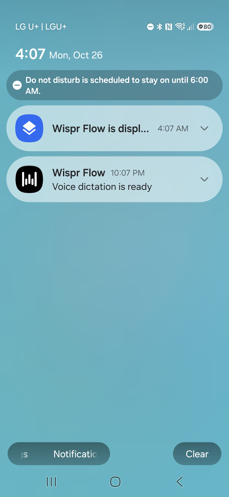

# Changes proposed for later

Updated: 2026-11-05 (Asia/Seoul).

Andrew is trying the current MVP and will report anything needing an immediate
fix. This is the standing list of later improvements and unfinished acceptance
work. Recording an idea here does not start its implementation. Current installed
build and measured results remain in [PROGRESS.md](PROGRESS.md).

## Deferred changes

1. **Automatic insertion after English approval.** Deferred again on November 5
   in favor of editable Korean in the manual MVP. The owned A35 test proved
   changed-field refusal and manual recovery. Two unchanged-middle runs reached
   the original field but refused before committing. The later trace identified
   six queued window notifications, including an added system window of unknown
   purpose. Preserve the default-OFF experiments and the records in
   [DEVICE_TESTS](docs/DEVICE_TESTS.md#system-managed-swiftkey-and-first-guarded-return-on-november-5).
   Any future attempt still requires owned empty/middle preservation, changed
   destination and interruption checks, then separate external acceptance.

2. **Make recording and processing states more obvious.** Andrew initially did
   not realize tapping a language choice immediately started recording. Improve
   the prominent recording label, timer or visual indicator; consider optional
   start/stop vibration or sound. The choice of feedback is still open. Stop and
   Cancel visibility was already fixed and phone-tested; broader menu polish
   remains later work. A mode-labelled recording banner and elapsed timer are
   now installed and phone-tested. Andrew found the first 3-bar pulse too small
   and the current 11-bar pulse too large, but chose to keep the latter for now.
   Later try a more restrained indicator or a voice-reactive waveform, after
   deciding whether the extra signal merits touching the audio-read path.
   Optional vibration/sound and clearer processing feedback remain proposals.

3. **Korean preview and editing.** Delivered in the November 5 manual MVP
   after four owned-fixture checks passed. The result panel shows the prepared
   Korean and supports local edits before Insert or Copy & close. Current
   implementation and acceptance status are in [PROGRESS](PROGRESS.md).

4. **An option to skip English review.** Initially every message keeps editable
   English review, as agreed. Later offer an explicit preference for skipping
   review when transcription is trusted. Decide its behavior and safeguards
   separately from automatic insertion after approval.

5. **Background readiness and recovery with minimal notification clutter.**
   Investigate idle survival, Samsung battery/sleep settings, service reconnection
   after updates/reboot/unlock, and an understandable status/repair screen.
   Andrew prefers KoScribe's current lack of persistent alerts. Compare the
   existing accessibility-overlay architecture with alternatives only when
   measured reliability or interaction benefits justify them. Keep the Wispr
   screenshot below as a reference; persistent notifications are not a selected
   KoScribe feature. Wispr's public setup guide attributes its ongoing notice
   to background operation, not to the insertion method (see docs/RESEARCH.md).

6. **Better compatibility with unsupported editors, including Karrot, OpenAI dot and Instagram comments.**
   Andrew reported OpenAI dot as another failing destination on November4; no
   focused-editor diagnosis has yet established its cause. This remains a
   separate follow-up to the selected automatic-flow goal. The
   current metadata probe found that Karrot does not expose the focused/editable
   field information guarded Insert requires. Keep Copy & close followed by
   normal Paste as the MVP route. Any future integration needs preservation and
   destination evidence; a blinking cursor alone is not sufficient reason to
   remove the safeguards.

   November5 source research verified ThumbFree's same-input-session virtual-field
   tests, a useful future adapter test reference. Its noneditable-host fallback
   and contextual postcheck are weaker than KoScribe's current destination/caret
   contract, so they are not accepted compatibility fixes. Ramblr's whole-field
   replacement and Verbally's unverified-write retries are unsuitable. No verified
   Karrot/dot results were found in this research; current scopes remain unchanged.

   On 2026-10-29 Andrew tried Insert into an empty Karrot chat and then tapped
   the field and tried again. Both were refused; KoScribe's own counters show no
   commit. Same-node metadata remained focused=0, editable=0 and input type zero
   even after a refresh. A later no-read diagnostic reached the pre-read
   boundary with stable input/root/node metadata, but did not establish the
   caret or safe insertion. A later approved single connection read returned
   an empty sample with unknown absolute offset. An independently safe
   alternative needs relative caret/context and postcommit evidence; no Karrot
   write trial has been authorized.

   On 2026-10-28 Andrew reported that KoScribe would not paste text into
   Instagram comments, while Instagram DMs work. On October 29 he clarified
   that the floating Insert first refused destination verification, then worked
   after he tapped the comment field again. The cause remains unverified. Preserve
   this successful reselect behavior while investigating reliability.

   Wispr's public Android documentation says its own insertion can fail and
   then falls back to clipboard. Compare Wispr's actual behavior in Karrot with
   an unsent draft before assuming it has a general solution for this editor.
   On 2026-10-29 Andrew reported that Wispr did insert directly into Karrot on
   his A35. This supports investigating a narrow Karrot adapter; it does not
   reveal Wispr's internal implementation or justify dropping KoScribe's guards.

7. **Broader layout and interruption resilience.** Test large fonts, small usable
   screen heights, rotation/split-screen, keyboard and app switching, calls,
   lock/unlock, draft expiry and service restarts. Improve compact controls and
   recovery where these tests expose problems. Existing tests cover bounded
   scenarios, not all daily-use combinations.

8. **A complete launcher-based fallback.** Keep the accepted direction available:
   home-screen app → microphone → editable English → choose 요/반말 → translate →
   Copy & close → normal Paste. The bubble already offers Copy & close; this
   complete launcher workflow has not been built.

9. **Personal installation and settings polish.** The visible “Phase 1” app and
   accessibility labels were replaced with KoScribe in the version 0.2
   in-place update. Later move beyond debug-only feature switches to a
   deliberately configured personal build and signed update process; continue
   improving setup/status controls.
   Protect the existing key and signing material; keep secrets outside Git and
   the APK, with confirmed DeveloperStuff backup for irreplaceable credentials.

10. **Custom vocabulary and correction rules for dictation.** Requested by
    Andrew after English transcription missed Korean app/brand and coffee-shop
    names during MVP use. First examples, preserved exactly as he supplied them:
    **Dangun pay** and **Twosome cafe**. Later evaluate a personal vocabulary list,
    pronunciation aliases and explicit corrections, with corrected English still
    available for review before translation. Preferred English/Korean spellings
    and the actual misrecognized forms have not been specified; confirm those
    when implementing rather than inventing replacement mappings. Deferred;
    no transcription or replacement behavior has changed.

11. **Visual design and accessible controls.** The October 31
    [phone screenshot audit](docs/design/UX_AUDIT_2026-10-31.md) found oversized
    mode/review surfaces, equal-weight gray buttons, a collision with Wispr's
    bubble, and a result control that does not show the Korean before Insert.
    Keep all three visible mode choices, editable English review, manual Insert,
    Copy & close, explicit Cancel/Hide, and SwiftKey. A compact native visual
    system is now implemented; any Korean snippet remains the unsettled option
    in item 3. Move can be tapped to switch sides as well as dragged. Assess
    TalkBack, larger type, reduced motion, contrast, and narrow viewports on
    device. The new recording panel uses a restrained decorative pulse with
    visible Stop and Cancel in the A35 sample check. Improve processing
    feedback or consider truly voice-reactive motion under item 2.
    Compare three visual directions in the
    [owner-private design review](https://koscribe-design-review.user78395.chatgpt.site)
    as the original HTML concepts. Andrew's review favored the compact mode card and proposed
    recording panel. The revised comparison uses the app's actual Spoken K
    foreground for the current bubble and a more square rounded-corner proposal
    inspired by Wispr's shape, without copying its mark. Bubble position remains
    user-draggable, so no position feature is proposed. Mode choices omit English
    politeness sublabels; the recording state may show Polite/Informal. Distinct
    secondary Hide bubble and Close panel buttons explain their current behavior.
    English review keeps a small label and editable text, without the proposed
    extra question/step heading. The result panel has one Cancel and a pill Move
    handle, no Korean preview, and remains necessary for manual Insert for now;
    eliminating it later is an idea, not implemented. The launcher/app home is
    separate from the daily bubble flow.

## Remaining acceptance work

- **Korean meaning and tone in both forms:** requests, apologies, questions,
  negation, names, numbers, scheduling and longer messages. One real edited 요
  translation passed; broader quality and 반말 acceptance remain open.
- **Latency and cost:** measure transcription and translation separately before
  proposing a different model or reasoning setting. The agreed translation
  model stays in place until a change is discussed.
- **Insertion preservation and recovery:** broaden current-build coverage for
  existing Korean/English/emoji, middle insertion, selected text and composition,
  alongside repeated use. Preserve the one-attempt rule for ambiguous commits,
  Microsoft SwiftKey and manual Send. Existing real-app trial scopes are consumed.

The selected light gray, translucent Spoken K and persistent small bubble after
completion are implemented and phone-tested. They are not pending design items.

## Wispr notification reference

Andrew supplied this image on 2026-10-26 and reports that these notices remain or
return after Clear. The original JPEG is preserved here:

- **Upper card:** the visible title is truncated to “Wispr Flow is displ…”. It
  appears to be Android's notice that an app is displaying over other apps.
  The full title is not visible. Wispr's own troubleshooting documentation
  discusses Android's overlay notification. This is a system visibility notice,
  rather than evidence of an insertion failure. [Wispr troubleshooting](https://docs.wisprflow.ai/articles/5002934560-Troubleshooting-the-Flow-Bar-%28Desktop%29-and-Flow-Bubble-%28Android%29)
- **Lower card:** Wispr Flow says “Voice dictation is ready”. Its setup guide
  explicitly associates this ongoing notification with background operation.
  The screenshot alone does not establish active microphone recording or the
  exact mechanism that restores a cleared notice. [Wispr Android setup](https://docs.wisprflow.ai/articles/8858845757-setup-wispr-flow-on-android-android-settings)

**Technical interpretation, checked 2026-10-26:** Android foreground services
have an associated status notification. KoScribe currently uses an accessibility
service and accessibility overlay; its manifest has no app-owned foreground
service or notification permission. These are different architecture choices.
The notification difference is a useful research lead for background readiness.
It does not establish why Wispr can insert automatically or show that adding a
notification would solve KoScribe's destination-continuity issue after review.
[Android foreground services](https://developer.android.com/develop/background-work/services/fgs),
[current manifest](app/src/main/AndroidManifest.xml),
[review-return evidence](docs/DEVICE_TESTS.md).

Preserve Andrew's preference for quiet operation when evaluating a future design.
Any required system notification belongs to the chosen architecture and its
Android requirements; adding an alert alone grants no additional editor access.
